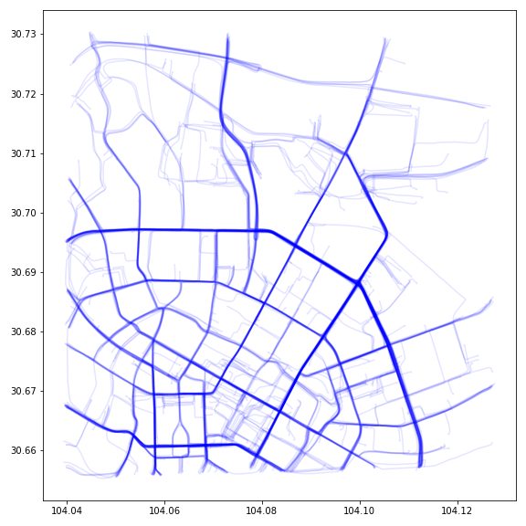

# DiffTraj: Generating GPS Trajectory with Diffusion Probabilistic Model

## Additional Notes by Erik

This directory is based on the DiffTraj repository found at: https://github.com/Yasoz/DiffTraj
I have made some modifications to the code and added additional files to make it more usable for my own purposes.
The original readme is included below.
If you want to use this code, please refer to the original repository and cite the original authors.

## Original Readme

### Requirements

You can install the required packages in your python environment by:

      python>=3.7
      torch>=1.7
      pandas
      numpy
      matplotlib
      pathlib
      shutil
      datetime
      colored
      math

### Train the trajectory generation model

1. Download the data with permission of using your own GPS trajectory data

2. Change the corresponding paths in the config.py and main.py files

3. Run and train the model by:

   ```bash
   python main.py 
   ```

4. The code will save the trained model every 10 epoches

### Usage for Trajectory Generation

Refer to Traj_Generation.ipynb file, we provide the fine-trained model (model.pt) simple guide infromation(heads.npy) example to explain how to generate trajectories.

### Generated result



### Reference

If you use this code, please cite:

```bibtex
@inproceedings{zhu2023DiffTraj,
    author = {Yuanshao Zhu, Yongchao Ye, Shiyao Zhang, Xiangyu Zhao and James, J.Q. Yu},
    title = {DiffTraj: Generating GPS Trajectory with Diffusion Probabilistic Model},
    booktitle = {Proceedings of the 37th Annual Conference on Neural Information Processing Systems},
    year = {2023}
}
```
